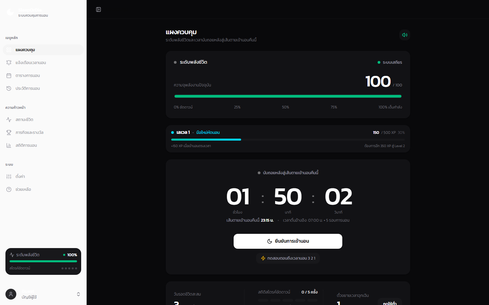
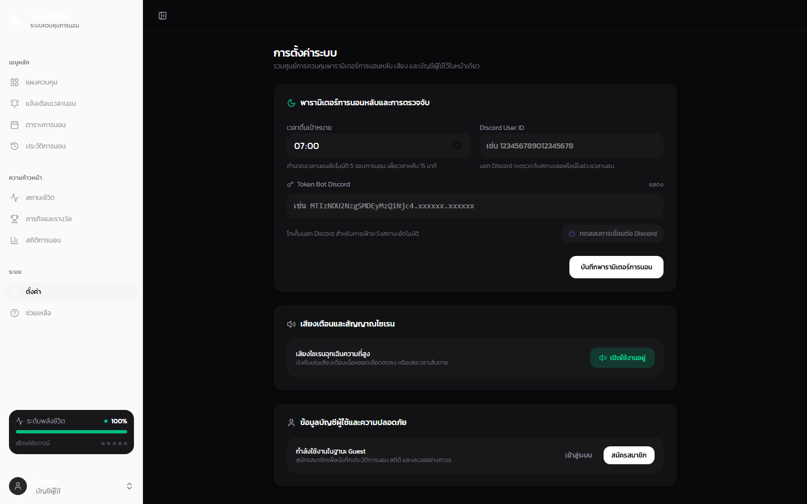
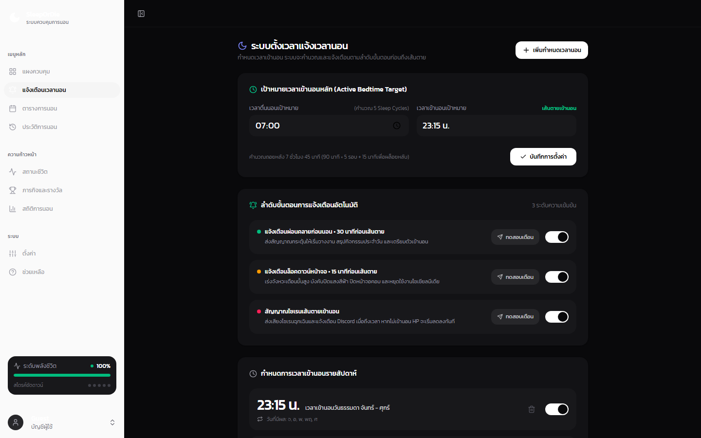
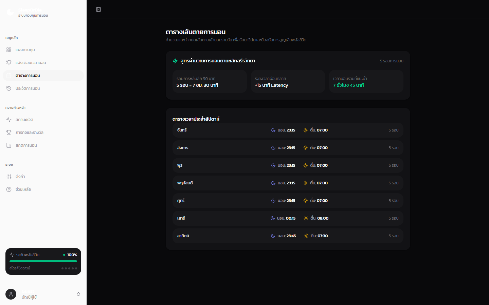
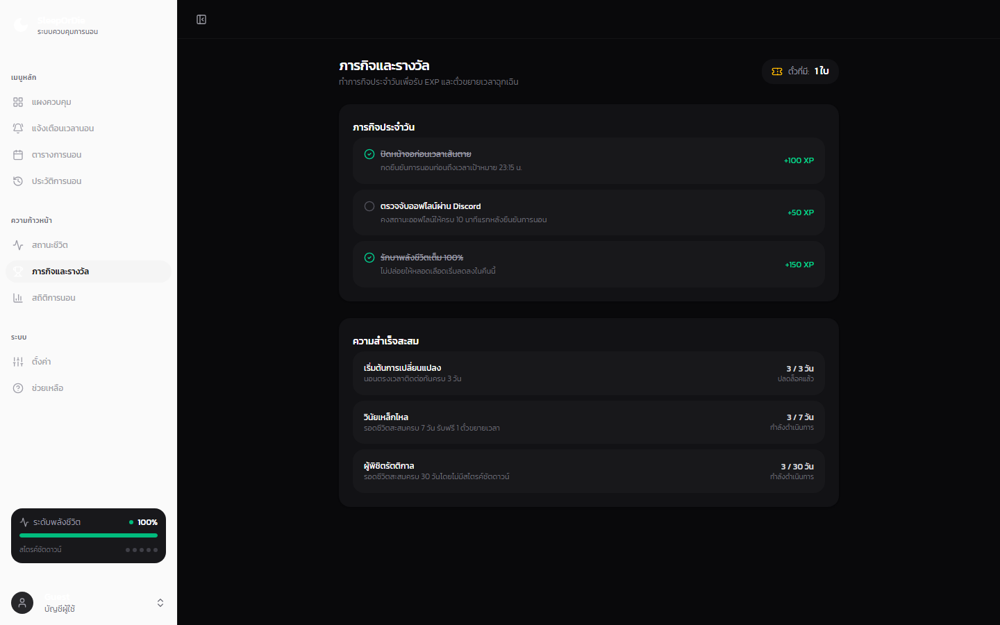
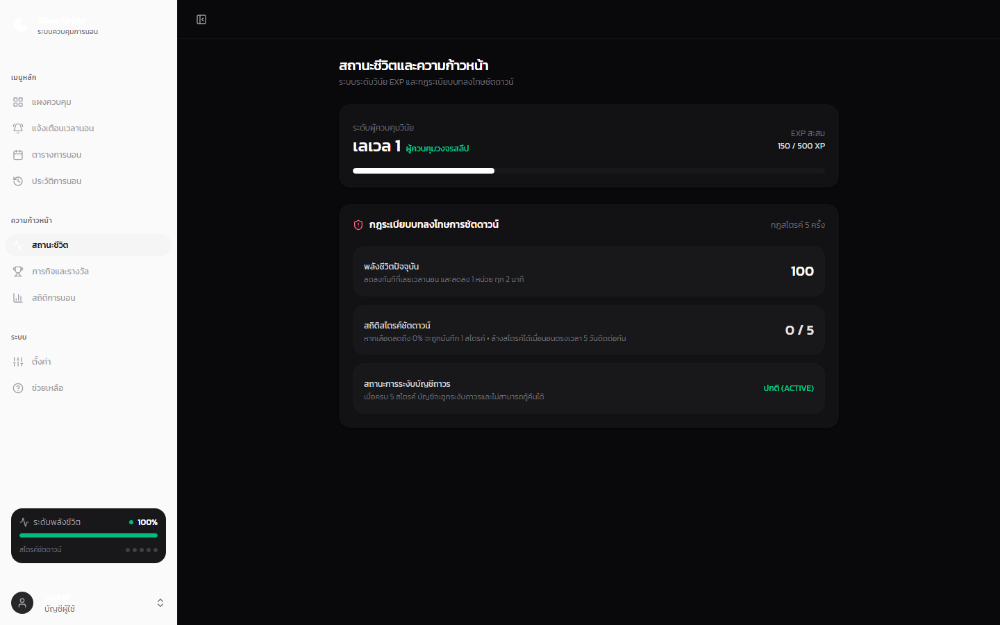
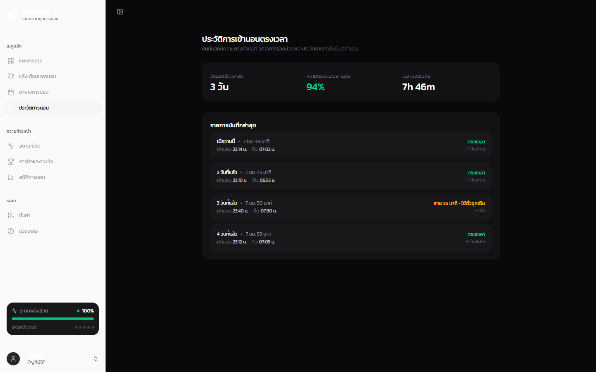
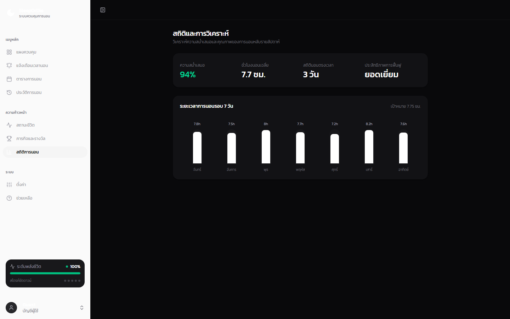
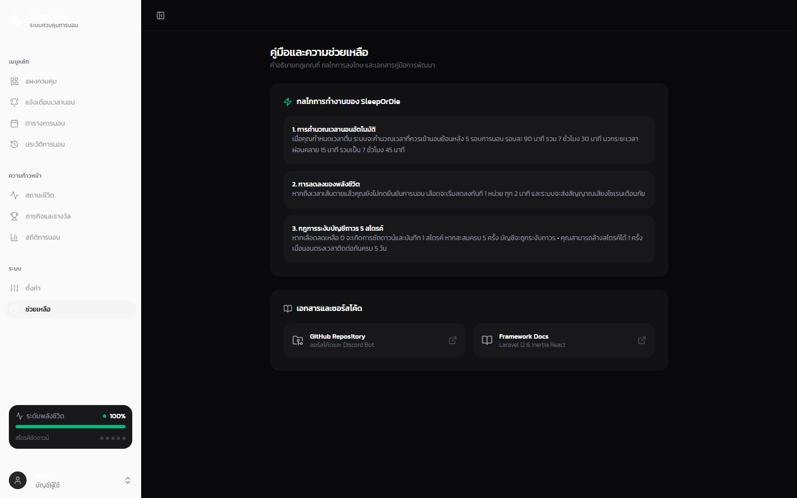

# ⏳ SleepOrDie (หลับหรือตาย)

> **Hardcore Biological Discipline & Gamified Sleep Accountability Protocol**  
> ปรับวินัยการนอนด้วยกลไกเกมสุดโหด หากละเลยไม่ยอมนอนจนพลังชีวิตหมด (0% HP) จะสะสมแต้มความล้มเหลว (Strikes) และเมื่อครบ 5 ครั้ง บัญชีจะถูก **กำจัดอย่างถาวร (Account Disabled / Permadeath)**!

---

## 📌 สารบัญ (Table of Contents)
1. [ภาพรวมของโปรเจกต์](#-ภาพรวมของโปรเจกต์)
2. [ภาพตัวอย่างหน้าจอระบบ](#-ภาพตัวอย่างหน้าจอระบบ)
3. [กลไกหลักของระบบ](#-กลไกหลักของระบบ)
4. [ลำดับเหตุการณ์บนหน้าจอ](#-ลำดับเหตุการณ์บนหน้าจอ)
5. [โครงสร้างเทคโนโลยี](#-โครงสร้างเทคโนโลยี)
6. [โครงสร้างโปรเจกต์](#-โครงสร้างโปรเจกต์)
7. [ขั้นตอนการติดตั้งและเริ่มใช้งาน](#-ขั้นตอนการติดตั้งและเริ่มใช้งาน)
8. [การรันระบบตรวจจับ Discord Bot](#-การรันระบบตรวจจับ-discord-bot)
9. [การทดสอบระบบ](#-การทดสอบระบบ)

---

## 🎯 ภาพรวมของโปรเจกต์

**SleepOrDie** ถูกสร้างขึ้นเพื่อแก้ปัญหาการผลัดวันประกันพรุ่งในการเข้านอน โดยเปลี่ยนการนอนให้กลายเป็นเกมเอาชีวิตรอด:
- **คำนวณเวลานอนอัตโนมัติ:** ผู้ใช้เพียงกำหนดเวลาตื่น ระบบจะคำนวณเวลานอนที่เหมาะสมตามหลัก Sleep Cycles (90 นาที x 5 รอบ + Buffer 15 นาที)
- **หลอดเลือดวัดวินัย (HP Bar):** พลังชีวิตเริ่มต้น 100% หากเลยเส้นตายแล้วยังไม่ยอมนอน HP จะลดลงเรื่อย ๆ
- **ระบบไอเทม & สถิติ:** สะสมจำนวน "วันรอดชีวิต" (Streak) และรับตั๋วขยายเวลา (Extension Ticket) ฉุกเฉิน
- **ระบบจับโกงอัตโนมัติ (Discord Guard):** บอทตรวจจับสถานะ Online บน Discord หลังจากกดยืนยันนอน หากแอบเปิดคอมเล่นเกมจะถูกลงโทษหัก HP ทันที

---

## 📸 ภาพตัวอย่างหน้าจอระบบ

### 1. แผงควบคุมหลัก - Dashboard
หน้าจอหลักรวมศูนย์แสดงเวลานับถอยหลังสู่เส้นตายเข้านอน หลอดเลือดพลังชีวิต Vitality HP Bar หลอดระดับเลเวลและ EXP สถานะวันรอดชีวิต และปุ่มทดสอบจำลองเวลาฉุกเฉิน 3 2 1


### 2. การตั้งค่าระบบ - Settings
หน้าต่างปรับแต่งเวลาตื่นเป้าหมาย คำนวณเวลานอนอัตโนมัติ พร้อมช่องใส่ Discord Bot Token และปุ่มทดสอบการเชื่อมต่อสด รวมถึงระบบเปิดปิดเสียงไซเรนฉุกเฉิน


### 3. ระบบตั้งเวลาแจ้งเวลานอน - Bedtime Alerts
กำหนดเป้าหมายเวลาเข้านอนหลัก (Active Bedtime Target) คำนวณรอบวงจรการนอน 5 Sleep Cycles อัตโนมัติ พร้อมลำดับขั้นตอนแจ้งเตือน (Alert T-30m > Lockdown T-15m > Deadline T-0m) และปุ่มทดสอบส่งการแจ้งเตือนทันที


### 4. ตารางเวลานอน - Schedule
คำนวณรอบวงจรการนอน 90 นาที จำนวน 5 รอบการนอน เผื่อเวลาเคลิ้มหลับ 15 นาที พร้อมตั้งตารางเวลาประจำสัปดาห์


### 5. ภารกิจและรางวัล - Quests
ระบบเควสต์รักษาวินัยประจำวันและสัปดาห์ เพื่อรับแต้มประสบการณ์ EXP และตั๋วต่อเวลาฉุกเฉิน


### 6. ระดับเลเวลและความก้าวหน้า - Progression
ระบบเลเวลพัฒนาการนอน แสดงสถิติ EXP สะสม อันดับแรงก์ และเหรียญตราเกียรติยศ


### 7. ประวัติการนอน - History
บันทึกประวัติการเข้านอนย้อนหลัง อัตราการรอดชีวิต และบันทึกแต้มความล้มเหลว


### 8. สถิติและการวิเคราะห์ - Analytics
กราฟวิเคราะห์แนวโน้มสุขภาพการนอนหลับ ความสม่ำเสมอของเวลาเข้านอน และรายงานพฤติกรรม


### 9. คู่มือและความช่วยเหลือ - Help
คู่มืออธิบายกฎเกณฑ์การเอาชีวิตรอด การตั้งค่าบอท Discord Guard และแอปพลิเคชันระบบปฏิบัติการ C++


---

## ⚔️ กลไกหลักของระบบ

### 1. ระบบพลังชีวิต (Health Points - HP)
- ผู้ใช้เริ่มแต่ละวันด้วย **HP 100%** (หลอดเลือดสีเขียว)
- ก่อนถึงเวลานอน (ช่วง Alert และ Lockdown) HP จะยังคงเต็ม 100%
- **เมื่อเลยเวลานอน (> T-0m):** HP จะเริ่มลดลงอย่างรวดเร็ว (นาทีละ ~1.6% หรือหมด 0% ภายใน 60 นาที) หลอดเลือดจะเปลี่ยนเป็นสีส้ม ➔ แดงกระพริบวิกฤต
- **เมื่อ HP เหลือ 0%:** ระบบจะเข้าสู่สภาวะ **Shutdown (จอดับสนิท)** และบันทึก **+1 Shutdown Strike**

### 2. บทลงโทษความล้มเหลว (Shutdown Strikes & Permadeath)
- สะสมได้สูงสุด **5 Strikes**
- **เมื่อครบ 5 Strikes:** บัญชีจะถูก **Disabled Account** อย่างถาวร (หน้าจอจะเปลี่ยนเป็น Digital Tombstone หลุมศพดิจิทัล สรุปสถิติสูงสุดและตัดสิทธิ์การใช้งาน)
- **ระบบลดหย่อน (Decay):** หากรักษาวินัยนอนตรงเวลาต่อเนื่องครบ **7 วัน (7-Day Streak)** ระบบจะลบ 1 Strike ออกเพื่อเป็นโอกาสแก้ตัว

### 3. ไอเทมตั๋วขยายเวลา (Time Extension Ticket)
- ได้รับ 1 ใบ เมื่อทำ Streak รอดชีวิตครบทุก 7 วัน
- กดใช้ในคืนฉุกเฉินเพื่อขยายเส้นตายเวลานอนออกไปได้ **+30 นาที** (จำกัดคืนละ 1 ใบ)

---

## 🚨 ลำดับเหตุการณ์บนหน้าจอ (Screen Stages)

| Stage | ช่วงเวลา | สถานะ HP | พฤติกรรมหน้าจอ | เสียงสัญญาณ |
| :--- | :---: | :---: | :--- | :--- |
| **Normal** | ก่อน T-30m | 100% | หน้าจอดำคลีน แสดงนาฬิกานับถอยหลัง | ไม่มีเสียง |
| **Alert** | T-30m ถึง T-15m | 100% | มีแถบเตือนสีเหลือง/ส้มด้านบน เตรียมตัวปิดงาน | เสียง Chime สองจังหวะ |
| **Lockdown** | T-15m ถึง T-0m | 100% | กรอบส้มเตือนกะพริบ บีบพื้นที่หน้าจอ เลขนับถอยหลังสีส้มชัดเจน | เสียงจังหวะหัวใจ (Heartbeat loop) |
| **Sleep** | เลย T-0m (เลยเส้นตาย) | กำลังลดลง | กรอบแดงกระพริบ ปุ่มเข้าสู่นิทราเต้นเร่งให้กด | ไซเรนฉุกเฉิน (Emergency Siren) |
| **Shutdown** | HP ถึง 0% | 0% | หน้าจอดำสนิท (Blackout) บันทึก 1 Strike ห้ามใช้งานต่อในคืนนั้น | เสียง Power-down ดับเครื่อง |
| **Tombstone** | สะสมครบ 5 Strikes | 0% | หน้าจอหลุมศพดิจิทัล บัญชีถูกระงับอย่างถาวร | ไร้เสียงสัญญาณ |

---

## 🛠️ โครงสร้างเทคโนโลยี (Tech Stack)

### Backend
- **Laravel 12 (PHP 8.5):** Core Framework
- **Pest PHP:** Automated Feature & Unit Testing
- **SQLite / MySQL:** Relational Database

### Frontend
- **Inertia.js (React 19) + TypeScript:** Client-side SPA
- **Tailwind CSS v4:** Modern Dark-mode & HUD Styling
- **Zustand:** Global Reactive Timer & Vitality State
- **Howler.js + Web Audio API:** Audio Synthesis & Siren loops
- **date-fns:** คำนวณวัน เวลา และ Timezone

### Microservices
- **Node.js (discord.js v14):** Discord Gateway Presence Guard Worker

---

## 📂 โครงสร้างโปรเจกต์ (Project Structure)

```
sleepordie/
├── app/
│   ├── Http/Controllers/
│   │   └── SleepController.php          # API สำหรับตั้งเวลา, ยืนยันนอน, ใช้ตั๋ว, Webhook
│   ├── Models/
│   │   └── User.php                     # User Model พร้อม Attributes (HP, Stacks, Streak)
│   └── Services/
│       └── SleepEngineService.php       # Logic การคำนวณเวลา, หัก HP, บันทึก Strike, ฟื้นฟูแต้ม
├── discord-bot/
│   ├── index.js                         # บอท Discord ดึง Presence ส่ง Webhook
│   ├── package.json
│   └── README.md
├── docs/
│   ├── adr/
│   │   └── 0001-sleepordie-core-engine.md # Architecture Decision Record
│   ├── superpowers/plans/
│   │   └── 2026-10-18-sleepordie-core-engine.md # แผนงานการพัฒนา
│   └── tech-stack.md                    # สรุปรายการ Dependencies
├── resources/js/
│   ├── components/Sleep/
│   │   ├── CountdownDisplay.tsx         # จอนับถอยหลังดิจิทัล + ปุ่มยืนยันนอน
│   │   ├── HpBar.tsx                    # หลอดเลือด 100% เปลี่ยนสีตามสถานะ
│   │   ├── SettingsModal.tsx            # Modal ตั้งค่าเวลาตื่นและ Discord ID
│   │   ├── StageOverlay.tsx             # Overlay กรอบเตือน Lockdown/Sleep/Shutdown
│   │   ├── StatsBadge.tsx               # ป้ายแสดงวันรอดชีวิต, Stacks, และตั๋ว
│   │   └── TombstoneScreen.tsx          # หน้าจอหลุมศพเมื่อ Account ถูกแบน
│   ├── lib/
│   │   └── audioManager.ts              # Web Audio Engine สำหรับเสียงเตือน
│   ├── pages/
│   │   └── dashboard.tsx                # Dashboard หลักของ SleepOrDie
│   └── stores/
│       └── useSleepStore.ts             # Zustand Store สำหรับนับถอยหลัง Real-time
├── routes/
│   ├── api.php                          # Webhook Route สำหรับ Discord Bot
│   └── web.php                          # Endpoints สำหรับเว็บแอป
└── GLOSSARY.md                          # คำศัพท์ทางการและนิยามของโดเมน
```

---

## 🚀 ขั้นตอนการติดตั้งและเริ่มใช้งาน

### 1. ติดตั้ง Dependencies ฝั่ง Backend & Frontend
```bash
# ติดตั้ง PHP Dependencies
composer install

# สร้างไฟล์ Environment และคีย์แอป
cp .env.example .env
php artisan key:generate

# รัน Migration ฐานข้อมูล
php artisan migrate

# ติดตั้ง Node Dependencies
pnpm install
```

### 2. รันแอปพลิเคชันในโหมด Development
เปิดรันทั้ง Server และ Vite ผ่าน Composer:
```bash
composer run dev
```
หรือรันแยกแท็บ:
```bash
# แท็บ 1: รัน Laravel Backend
php artisan serve

# แท็บ 2: รัน Vite Frontend
pnpm run dev
```
เข้าใช้งานผ่านเบราว์เซอร์ที่: **`http://127.0.0.1:8000`**

---

## 🤖 การรันระบบตรวจจับ Discord Bot

บอท Discord จะทำหน้าที่คอยส่องว่าเป้าหมายยังเปิดคอมหรือเล่นเกมอยู่ในช่วง 10 นาทีหลังจากกดยืนยันนอนหรือไม่:

1. เข้าไปที่โฟลเดอร์บอท:
   ```bash
   cd discord-bot
   ```
2. ติดตั้งแพ็กเกจ:
   ```bash
   npm install
   ```
3. คัดลอกและตั้งค่า `.env`:
   ```bash
   cp .env.example .env
   ```
   ใส่ **`DISCORD_BOT_TOKEN`** และ **`TARGET_DISCORD_USER_ID`**
4. สตาร์ทบอท:
   ```bash
   npm start
   ```

---

## 🛡️ การรันแอปพลิเคชันฝั่ง Desktop (Native C++ System Tray Guard)

โปรแกรม Native C++ สำหรับระบบปฏิบัติการ Windows ทำงานแบบ System Tray ในพื้นหลัง เพื่อเฝ้าระวังวินัยและบังคับใช้มาตรการจริง:

1. **คอมไพล์โปรแกรม (หากต้องการบิลด์ใหม่):**
   ```cmd
   cd desktop-daemon
   build.bat
   ```
2. **การเปิดใช้งาน:**
   - ดับเบิลคลิกที่ **`SleepOrDieGuard.exe`** ตัวโปรแกรมจะเข้าไปรันเงียบ ๆ บน System Tray (Taskbar Notification Area)
   - นำเมาส์ไปชี้ที่ไอคอนเพื่อดูเวลาที่เหลือจนถึงเส้นตายและสถานะ HP
   - คลิกขวาที่ไอคอนเพื่อดูสถานะ หรือกดจำลองการทดสอบ 3-2-1
   - **มาตรการบังคับใช้:** เมื่อถึง T-15m โปรแกรมจะสั่ง `LockWorkStation()` ล็อกหน้าจอ Windows และเมื่อ HP เหลือ 0% จะสั่งเครื่องเข้าสู่โหมด Windows Sleep/Standby ทันที

---

## ☁️ การเตรียมการ Deploy ขึ้น Render Cloud

โปรเจกต์รองรับการ Deploy สู่ **Render Cloud** ผ่าน Render Blueprint ควบคู่กับ Supabase PostgreSQL:

1. Push โค้ดขึ้น Git Repository
2. เข้าสู่ **Render.com** ➔ เลือก **New Blueprint**
3. เลือก Repository โปรเจกต์ Render จะอ่านไฟล์ `render.yaml` และเตรียมทรัพยากร:
   - **`sleepordie-web`**: Web Service (Docker Nginx + PHP-FPM) พร้อมพอร์ต 10000
   - **`sleepordie-scheduler`**: Background Worker รัน `php artisan schedule:work` ทุก 1 นาทีเพื่อส่งแจ้งเตือนเวลานอน
4. กรอกค่า **`DB_PASSWORD`** จากไฟล์ `supa.txt` ในช่อง Environment Variable และกด Deploy ได้ทันที

---

## 🧪 การทดสอบระบบ (Testing & Verification)

โปรเจกต์มีชุดทดสอบครอบคลุมทั้ง Unit Tests และ Feature Tests ด้วย Pest:

```bash
# รันชุดการทดสอบทั้งหมด
php artisan test

# ตรวจสอบความถูกต้องของการจัดฟอร์แมตโค้ด
vendor/bin/pint --test --format agent

# บิลด์ทดสอบโปรดักชันของ Frontend
pnpm run build
```

---

## 📜 ข้อกำหนดและสิทธิ์การใช้งาน
พัฒนาภายใต้ [MIT License](LICENSE)
